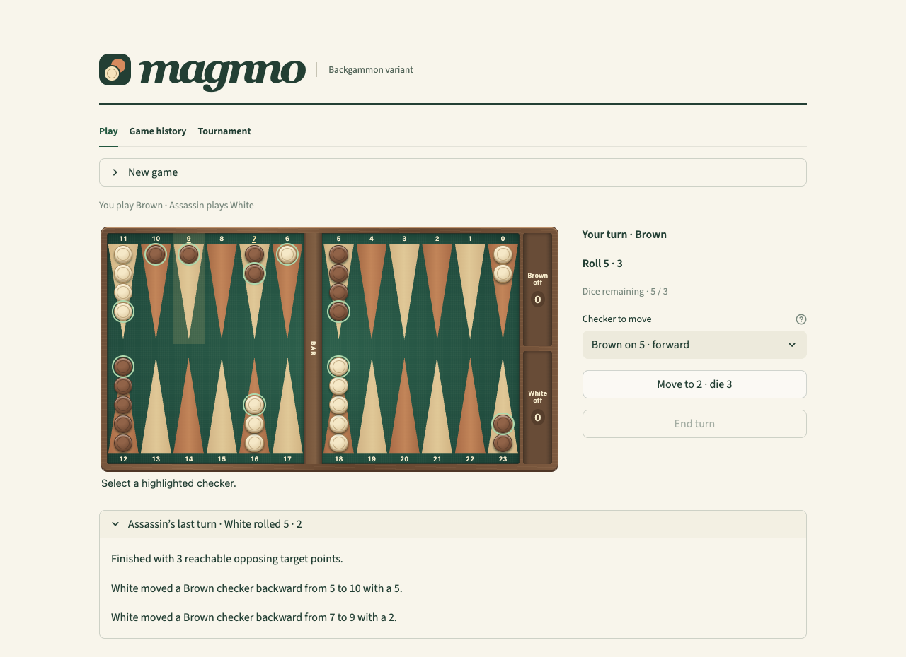

# magnno

magnno is a backgammon variant where each die can advance your own checker
or move an opposing checker backward. The first player to bear off one checker
wins. The browser game, turn generator and self-play sampler share one rules engine.

## Streamlit app

From this repository, create a Python environment and start the web app.

```sh
python3 -m venv .venv
source .venv/bin/activate
python -m pip install -r requirements.txt
python -m streamlit run streamlit_app.py
```

**Play** starts a game against Baseline. Choose **New game** to select
your color and opponent. Baseline, Sprinter, Fortress, Saboteur, Assassin,
Blockader, Optimizer, Hoarder and Random all use the same rules. Select a legal source and destination
on the board, or use the move controls alongside it. You can undo a move
before ending your turn. After either player wins, **Save to History** adds
the completed game once, with both players, every roll, each checker move and
the bot’s turn explanations.



**Game history** contains all 100 bot-versus-bot games from the revised
experiment (seeds 2026–2125), as well as saved human-versus-bot games. Filter
by matchup, pick a game, and step or scrub from the opening to the winning
move. Each record identifies both players by color and strategy.
Seed 2095 is the shortest baseline game at 13 turns.

**Tournament** displays the head-to-head matrix and playing styles measured
in the bundled round robin. The simulation cap is **2,000 player turns**,
including the opening turn and forced passes. A winning move on turn 2,000 counts.
Switch denominators to inspect wins among all
starts, wins among completed games, or games that reached the turn limit.
To inspect a different run, set `MAGNNO_TOURNAMENT_REPORT` to the JSON
file written by the tournament or matchup command before starting Streamlit.

Human games are shared by visitors to the same app instance once saved.
By default the app writes them to `data/history.sqlite3`. Set
`MAGNNO_HISTORY_DB` to a path on a persistent disk to keep them across
redeployments. The bundled baseline replays are read directly from the
repository. For a Streamlit deployment, use `streamlit_app.py` as the entry point.

Run the test suite with `python -m unittest discover -v`. To rebuild the
bundled histories with verification against the original experiment, run
`python record_baselines.py`.

## Standalone visualizer

Run `python visualizer.py` for the original browser table. On a Mac you
can also double-click **Play.command**. The launcher uses
`.venv/bin/python` if you created a virtual environment in the project.
Select a human or any registered agent for White and Brown independently.
You can watch two agents using the pause and step controls. Select a checker,
then a highlighted destination. **Board state** shows the signed point counts
and separate bar counts. Stop the local server with Ctrl-C.

Choose **Replay** to watch the shortest of the 100 games played by the
revised heuristic. Seed 2095 took 13 turns and 34 checker moves. Use
**Next move** or **Previous move**, press the left and right arrow keys, or
drag the slider to jump. The dice, bar and bear-off trays show the position
at the selected move. You can also open `magnno-replay.html` directly in a
browser for the same replay offline.

## The 27-byte state

| Field | Type | Meaning |
| --- | --- | --- |
| `state.board` | NumPy `int8[24]` | Positive White stacks, negative Brown stacks, zero for empty points. Read-only. |
| `state.white_bar`, `state.brown_bar` | Two `uint8` scalars | Checkers waiting to enter for each color. |
| `state.player` | `int8` | `WHITE = +1`, `BROWN = -1`. |

`serialize_state(state)` returns exactly 27 bytes in the order shown, with
signed values in two's complement and no padding. The packed buffer backs
the point array. A live Python object also has an object header and a NumPy
array header. See [measured memory and throughput](BENCHMARKS.md).

`white_off` and `brown_off` are computed properties. For each color, subtract
its bar count and its total checkers on points from 15. A live game has 15
checkers per side on points or bar. A finished game has 14 for the winner
and 15 for the other color. Deserialization validates these totals before
returning a position.

White starts with 2 checkers at point 0, 5 at 11, 3 at 16 and 5 at 18.
Brown has the same counts at 23, 12, 7 and 5. Both move in the active
player's direction, including an opposing checker moved backward.

| | White to play | Brown to play |
| --- | --- | --- |
| Forward direction | Increasing point index | Decreasing point index |
| Bar entry on die `d` | `d - 1` | `24 - d` |
| Home half | 12–23 | 0–11 |
| Distance from point `i` to the tray | `24 - i` | `i + 1` |

In a `Move(checker, source, target, die)`, `checker` is the **moved** color.
`BAR = 24` is a source and `OFF = 25` is a destination. These are move
codes outside the physical board. Both colors share those codes.

## Rules

- The opening roll is one die per color. Reroll ties. The higher roller
  plays both dice. Later rolls use two dice, with four steps on doubles.
- Use as many dice as possible. On a nonwinning turn where only one die
  can be played, use the higher die if playable. When fully blocked, pass.
- A moved checker may land on an empty point, a stack of its color or a
  lone checker of the other color. The lone checker goes to its own bar.
  Two or more checkers of the other color block the point.
- Moving an opponent onto your own blot hits your blot. You must enter all
  your bar checkers before doing anything else, even midway through a roll.
  A bar entry can hit a blot. Opposing checkers can only be moved backward
  between physical points.
- You may bear off once every remaining checker of your color is in your
  home half and your bar is empty. An exact die may bear off that checker.
  An oversized die may bear off only your farthest checker. For example,
  with 14 White checkers on point 12 and one on 18, a six bears off the
  checker on 18. With that lone checker on 23, only a one bears it off
  while the stack stays on 12.
- A first bear-off ends the game immediately, including on a smaller die
  or with dice left. There is no built-in turn limit or automatic draw.

The ordinary play rules follow the [U.S. Backgammon Federation's rules](https://usbgf.org/backgammon-basics-how-to-play/).

## Agent framework

Choose a policy by stable name. The same interface works in live matches,
color-swapped matchups, self-play, and tournaments.

```python
from random import Random
from agents import create_agent
import backgammon as game

state = game.starting_state()
agent = create_agent("optimizer", config={"bar_penalty": 4, "sacrifice_threshold": 0.4})
turn = agent.choose_turn(state, (2, 3))
print(agent.explain(state, turn))

rng = Random(2026)
# Draw from a fixed opponent distribution for successive games.
opponent = create_agent(rng.choices(["sprinter", "fortress", "random"], weights=[4, 4, 2])[0],
                        seed=rng.getrandbits(64))
```

```sh
python simulation.py matchup sprinter fortress --games 20 --max-turns 2000 --out matchup.json
python simulation.py tournament --games 20 --seed 2026 --max-turns 2000 --workers 7 --out tournament.json
python simulation.py tournament --games 2 --seed 7401 --max-turns 2000 --sample-every 20 --positions samples.sqlite --out sample-run.json
python benchmark_agents.py --games 90 --rounds 2 --out timings.json
```

- Read the [decision trees, sacrifice thresholds and parameters](AGENTS_GUIDE.md) and [shared feature definitions](FEATURES.md).
- See [simulation, statistics and compact training records](SIMULATION.md) for the experiment conventions and data reader.
- Inspect the [measured tournament and benchmark results](results/REPORT.md), the [full machine-readable tournament](results/round-robin.json) and a [sample of labeled positions](results/sample-positions.sqlite).

## Synthetic value dataset

The [synthetic data guide](SYNTHETIC_DATA.md) covers the 5,000-game pilot, the separate 80,000-game command, and loading pre-roll positions or replaying trajectories. Each labeled position comes from a completed game and carries the actual outcome for the side to move.

## Historical baseline

`heuristic.choose_turn(state, dice)` scores legal full turns, including
alternative move orders, and returns its chosen moves and next state. The
archived 100-game experiment uses this original blot-based policy. The
registry’s Baseline uses effective vulnerability and the shared capture-value
definition. The following command reproduces the historical policy experiment.

```sh
python3 selfplay.py --games 100 --seed 2026 --turn-limit 300
```

The [policy and self-play results](HEURISTIC.md) explain the six priorities,
the self-hit exception, and the comparison on the same 100 seeds. The
[revised 300-turn report](heuristic-revised-selfplay.json) includes length
distributions and raw event counts. The [uncapped results](heuristic-revised-100-games.csv)
give the winner and full length of each game.

## Self-play and search

```python
from random import Random
from backgammon import opening_roll, roll_dice, sample_turn, starting_state, winner

rng = Random(42)
player, dice = opening_roll(rng)
state = starting_state(player)
for _ in range(500):  # An external rollout budget.
    turn = sample_turn(state, dice, rng)
    state = turn.state
    if winner(state) is not None:
        break
    dice = roll_dice(rng)
```

- `legal_turns(state, dice)` returns one `Turn(moves, state)` per distinct
  resulting position. Each child already contains the next player, including
  on a pass or win. A forced pass has empty moves. A terminal position has
  no children. `winner(state)` gives the winning color or `None`.
- `sample_turn(state, dice, rng)` chooses uniformly among those distinct
  results and constructs a NumPy state only for the selected child.
- `apply_turn(state, dice, moves)` validates a complete sequence, including
  an alternative legal order reaching the same position. `turn_options`
  accepts a partial sequence and returns the preview state, all viable next
  moves and a completion flag. A preview keeps the moving player's sign.
- `state_key(state)` returns the position's exact 27 bytes for a transposition
  table. Key a decision after a known roll by `(state_key(state), tuple(sorted(dice)))`.
  A pre-roll chance node can use just the state key. State equality compares
  the full payload. `hash(state)` uses a deterministic 64-bit BLAKE2b digest.
- The generator modifies and undoes moves in one scratch buffer. It deduplicates
  intermediate positions by their bytes **and unused dice**. Search checks for
  a winning bear-off at the step where it happens.

### Import a position from the previous engine

`from_legacy(cells, player)` accepts the original 27 count pairs and a **signed**
player. Convert old player ID 0 to `WHITE` and old ID 1 to `BROWN`.
Old physical indices 2–25 become 0–23. The shared bar and both trays are
checked on import. `to_legacy(state)` reverses the conversion. Reduced-checker
puzzles from the old engine need full-count equivalents because every missing
checker now represents a bear-off. The local browser's JSON interface retains
the previous wire coordinates so existing sessions can continue.

## Neural inputs and training files

`training.encode_state(state, dice=None)` builds float32 arrays on demand.
Its board is shaped `(2, 24)`. Channel 0 contains the active player's counts,
always moving toward higher encoded indices. Channel 1 contains the opponent's.
For Brown, physical point `i` maps to encoded index `23 - i`. Auxiliary values
are active bar, opponent bar, active off and opponent off. A pre-roll input
has `dice=None`. Supplying a roll adds six face counts, so (2, 5) and (5, 2)
encode identically, and double threes put a 2 in the third bin.

```python
from backgammon import legal_turns, starting_state
from training import TrainingRecord, encode_state, read_records, write_records

state = starting_state()
dice = (3, 1)
turn = legal_turns(state, dice)[0]
# Supply the eventual absolute winning color when the game ends.
rows = [TrainingRecord(state, dice, turn.moves, winner=None)]
with open("positions.fobg", "wb") as stream:
    write_records(stream, rows)
with open("positions.fobg", "rb") as stream:
    for row in read_records(stream):
        inputs = encode_state(row.state, row.dice)
        value = row.value_target  # +1 win, -1 loss, or None if unlabeled.
```

A record is **29 bytes plus 2 per move**, up to 37 bytes for four moves.
The versioned file has a five-byte header. One million ordinary two-move
records occupy 33,000,005 bytes. The writer accepts an iterable and the
reader yields one record at a time. Roll order, checker color, source,
destination, die, and step order all survive a round trip. An absent action
and an explicitly chosen pass have distinct encodings. `training.py` documents
the byte layout. Terminal outcomes are absolute signed colors; `value_target`
converts them to the recorded active player's perspective.

## Reproduce the measurements

```sh
python3 benchmark.py
```

[BENCHMARKS.md](BENCHMARKS.md) reports memory, legal-turn generation, and
completed games per second with policy, seeds and turn cap. Caps are counted
separately from wins. The regression suite also compares generated afterstates
and first moves against fixtures recorded with the previous rules engine.
